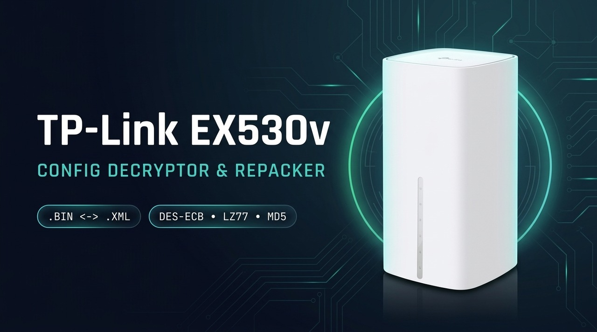

# TP-Link EX530v Configuration Decryptor & Repacker



<p align="center">
  
</p>

<p align="center">
  <a href="https://github.com/laserbirdx/ex530vconf/releases"></a>
  
  
  
  <a href="LICENSE"></a>
</p>

A lightweight, standalone configuration decryptor, LZ77 decompressor, and repacker for **TP-Link EX530v (AX3000 Wi-Fi 6 VoIP Router — Volcano Platform)** backup files (`.bin` ⇄ `.xml`).

Edit restricted ISP parameters (such as Superadmin/root credentials, VoIP/SIP settings, TR-069/CWMP management locks, VLAN IDs, DNS, and hidden Wi-Fi options) by unpacking the encrypted `.bin` configuration backup into human-readable `.xml` and repacking it back into a valid signed `.bin` archive ready to restore on the router.

---

## Key Features

- **Bidirectional Conversion (`.bin` ⇄ `.xml`):**
  - **Unpack (`.bin` → `.xml`):** Decrypts the `DES-ECB` outer layer, strips the 16-byte `MD5` header, and decompresses the proprietary TP-Link `LZ77` payload into plain XML.
  - **Repack (`.xml` → `.bin`):** Compresses edited XML with genuine hash-chain `LZ77` match-finding, prepends a fresh 16-byte `MD5` digest, pads to an 8-byte block boundary, and re-encrypts with `DES-ECB`.
- **Standalone Windows Executable (`ex530vconf.exe`):** No Python installation required on Windows—available directly in [**Releases**](../../releases) with a custom TP-Link EX530v application icon.
- **3 Convenient Ways to Use on Windows:**
  1. **Double-Click Mode:** Opens native Windows *Open* and *Save As* file dialogs automatically.
  2. **Drag & Drop Mode:** Drag any `.bin` or `.xml` file directly onto `ex530vconf.exe` in File Explorer for instant one-step conversion.
  3. **Command-Line (CLI) Mode:** Pass `<input>` and `<output>` paths (plus `-q` / `--quiet` for headless scripting).
- **Zero External Dependencies in Source Mode:** Automatically installs `pycryptodome` on first run if missing when invoked as a Python script.

---

## Download Standalone Executable

Grab the pre-built single-file Windows executable from the [**Releases**](../../releases) page:

| Platform | Executable | Size | Architecture | Notes |
| :--- | :--- | :--- | :--- | :--- |
| **Windows 10 / 11** | [`ex530vconf.exe`](https://github.com/laserbirdx/ex530vconf/releases/latest/download/ex530vconf.exe) | ~9.5 MB | 64-bit (`x64`) | Standalone single-file executable (Double-Click, Drag & Drop, or CLI) |

---

## Unlocking Hidden Backup & Restore Controls in Web UI

Many ISP-branded **TP-Link EX530v** firmware builds hide the configuration **Backup** and **Restore** buttons in the router's web administration interface. To reveal them:

1. Log in to your TP-Link EX530v web interface (typically `http://192.168.1.1`).
2. Press **`F12`** (or `Ctrl+Shift+I`) in your browser and open the **Console** tab.
3. Run the following JavaScript commands one after another:

```javascript
// 1. Navigate directly to the Backup & Restore module
$.loadMain("/backNRestore.htm");
```

```javascript
// 2. Unhide hidden Backup and Restore buttons
document.querySelectorAll('.s_backup, .s_restore').forEach(el => {
  el.style.display = '';
});
```

4. Click **Backup** to download your router's `.bin` configuration file, edit it using `ex530vconf`, and use **Restore** on the same page to upload your repacked `.bin` file.

---

## Usage

### Option 1: Standalone Windows Executable (`ex530vconf.exe`)

- **Interactive File Picker:** Simply double-click `ex530vconf.exe`, select your `.bin` or `.xml` file, and choose where to save the converted output.
- **Drag & Drop:** Drag `conf.bin` onto `ex530vconf.exe` → produces `conf.xml` in the same folder. Drag `conf.xml` onto `ex530vconf.exe` → produces `conf_repacked.bin` (preserving your original `conf.bin` backup).
- **Command Line (PowerShell / CMD):**

```powershell
# Decrypt & decompress (.bin -> .xml)
.\ex530vconf.exe conf.bin conf.xml

# Compress & encrypt (.xml -> .bin)
.\ex530vconf.exe conf.xml conf_modified.bin

# Silent / headless mode (suppresses completion dialog box)
.\ex530vconf.exe --quiet conf.bin conf.xml
```

### Option 2: Running from Python Source

Requires **Python 3.8+**:

```bash
pip install -r requirements.txt

# Decrypt .bin to .xml
python dec.py conf.bin conf.xml

# Encrypt .xml back to .bin
python dec.py conf.xml conf_modified.bin
```

---

## Binary Format & Cryptographic Details

TP-Link EX530v (Volcano platform) configuration backups follow this binary layout:

| Offset (Decrypted) | Size | Description |
| :--- | :--- | :--- |
| `0x00` | `16 bytes` | Raw **MD5** digest computed over the compressed LZ77 payload |
| `0x10` | `4 bytes` | Uncompressed XML size (`uint32`, little-endian, NUL-terminated) |
| `0x14` | `Variable` | **TP-Link LZ77** compressed bitstream (16-bit flag words + Elias-like length/distance coding) |
| `End` | `0–7 bytes` | Zero-byte (`0x00`) padding to 8-byte block boundary |

- **Cipher:** `DES` in `ECB` mode (`DES-ECB`)
- **Static Key:** `40 BB C6 6D CB 5A 1D FE` (`b'\x40\xbb\xc6\x6d\xcb\x5a\x1d\xfe'`)

---

## Building the Executable from Source

To build `ex530vconf.exe` yourself with the custom icon:

```powershell
pip install pycryptodome pyinstaller
python -m PyInstaller --noconfirm --clean --onefile --name ex530vconf --icon assets/logo.ico dec.py
```

---

## Credits & Acknowledgments

- Original reverse engineering & algorithm implementation by [**ods-code**](https://github.com/ods-code/ex530vconf) / **BYF Support** ([Techolay](https://techolay.net)).
- Packaged, documented, and maintained by [**laserbirdx**](https://github.com/laserbirdx).

---

## License

This project is licensed under the [MIT License](LICENSE).
